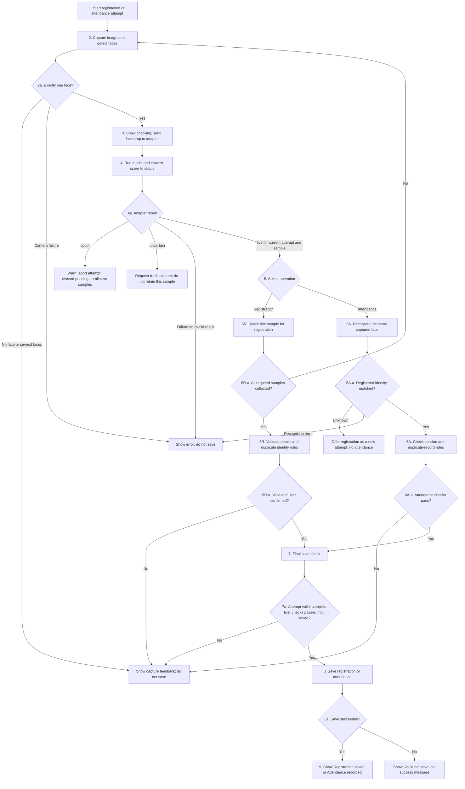

# LIV-02 — Liveness checks for registration and attendance

Version: **LIV-02-v1**, written **6 November 2026**. Task owner: **Trang**. GUI owner and reviewer: **Vỹ**. Trang defines the contract in this document; Vỹ reviews it and agrees on how the GUI will use it. Their agreement has not yet been recorded.

## Purpose and scope

Before the application saves a new registration or an attendance record, it must check that the face used for that operation has a valid live result. This requirement is called **liveness gating** throughout this document. A face-recognition match alone is insufficient: a photograph or replay may match a registered person while still being a spoof.

LIV-02 defines three things:

- How liveness affects registration and attendance, including the messages shown for live, spoof and uncertain input.
- The rule that a detected spoof cannot produce a genuine registration or attendance record.
- The information exchanged between the liveness module and GUI, and how the GUI changes state when results arrive or become invalid.

These are the design requirements for LIV-02 in the group's [WBS and Rubric Requirements](https://docs.google.com/spreadsheets/d/1ItpF11JBlpcTnNiADI-Qm-cDmexBuLRzuHBW5uDChLw/edit?usp=sharing). Working integration with trained models is checked separately under **UI-04**. In particular, **UI-04.6** covers the liveness adapter running in the GUI and its live/print/replay tests.

This document specifies the intended liveness behavior. Implementation and webcam test results are assessed under UI-04.

## Rules for saving records

**If the liveness module detects a spoof, the application must not save that input as a genuine registration or attendance event.** The same restriction applies to uncertain, missing and invalid results, and to camera or inference failures.

A live result permits the application to continue checking the operation. It does not by itself prove the person's identity or mean that a record has been saved. Attendance also requires a match to a registered identity. Registration also requires valid registration details and the enrollment checks defined in UI-01, the task responsible for registration and gallery storage.

The GUI must disable the registration/attendance confirmation control when liveness has not passed. The application must also check the rule immediately before writing data, so a stale callback or a direct function call cannot bypass a disabled button. Emotion predictions never authorize registration or attendance.

A stub is a simulated model used for the SYS-05 webcam prototype. Its results must be marked as a demo and must not create genuine registration or attendance records.

## What the user sees

The following table compares the UI response and permitted behavior for each input state. “Verified identity” means a person shown as having passed both liveness and face recognition for the current capture.

| Input or processing state | Message shown | Identity display and controls | May the application save a record? |
| --- | --- | --- | --- |
| checking: inference is still running | “Checking liveness…” | Clear the previous verified identity and success message; disable confirmation | No |
| live: the current face passes liveness | “Live face detected” | Continue the identity or enrollment checks for the same capture | Only after all checks for that operation pass |
| spoof: the input is classified as an attack | “Spoof detected — registration/attendance blocked. Use your live face.” | Clear the verified identity; disable confirmation; offer retry | No, even if face recognition finds a match |
| uncertain: liveness cannot be confirmed | “Cannot confirm liveness — try again with your face clearly visible.” | Clear the verified identity; disable confirmation; offer retry | No |
| no_face: no face is detected | “No face detected — face the camera.” | Clear liveness, identity and emotion results; disable confirmation | No |
| multiple_faces: more than one face is detected | “One person at a time.” | Clear liveness, identity and emotion results; disable confirmation | No |
| error: the camera or model cannot produce a valid result | “Camera unavailable — reconnect and retry” or “Liveness unavailable — retry” | Clear previous results; disable confirmation | No |

Use text alongside any colour or icon. A previous attendance record may remain in the history view, but must not appear as the identity currently verified by the camera. Clear the current emotion display whenever its face/capture is invalidated.

## Terms used in the flows

- **Attempt:** one registration or attendance operation, identified by attempt_id. Switching between registration and attendance, or retrying an aborted operation, starts a new attempt.
- **Capture:** one image taken from the camera, identified by capture_id. Each captured image has its own identifier.
- **Face:** the face region detected within a capture. face_id identifies that region within the image; it is not an employee ID and does not prove identity. A capture can contain zero, one or several faces. This flow requires exactly one.
- **Face crop:** the pixels cut out around the selected face. Liveness and recognition use this same source face, although each model may resize or normalize it differently.
- **Enrollment sample:** a face crop and its associated result/data considered for registration. A **retained sample** is a sample kept temporarily after it passes liveness, for later inclusion in the registration. Retained does not mean already saved as an active identity.

If UI-01 requires multiple enrollment samples, each sample must pass liveness independently. LIV-02 does not prescribe a sample count.

## Registration and attendance flow

Steps 1–4 are shared. Steps 5R–6R cover registration; steps 5A–6A cover attendance. Both branches continue through steps 7–9 when their checks pass. Decision nodes use the parent step number with a letter suffix.

uncertain requires a new capture; spoof aborts the attempt and requires an explicit retry with a new attempt ID. Missing faces, multiple faces and operational errors also block saving. A failed or uncertain sample cannot be retained for enrollment. A spoof discards all uncommitted samples from that registration attempt.

**Step 7 — Final save check** runs immediately before step 8 writes the record. It is an application processing step, not another liveness input state: liveness must still be live for the data being saved. Its outcome is proceed to saving or refuse to save; success is displayed only after persistence succeeds.

The checks specific to each operation are:

- **Registration:** valid registration details, the required number of individually live samples, UI-01's duplicate-ID/identity rules, and user confirmation. Save the identity and embeddings together so failure leaves no active partial identity.
- **Attendance:** a registered identity matched on the same captured face, a valid attendance session where the application requires one, and its duplicate-record rules. LIV-02 does not define the session or duplicate policy; those belong to the attendance feature.

Registration does not automatically record attendance. Starting attendance or selecting registration from the unknown-person prompt starts a separate attempt and repeats liveness. A blocked attempt may produce diagnostic information, but must not become a genuine attendance event or active gallery identity.

## Contract between the liveness adapter and GUI

An **adapter** is the component that prepares the face crop for the model, runs inference and returns a consistent result to the application. Trang defines its liveness behavior. Vỹ uses the contract to connect that result to GUI states and registration/attendance actions.

The fields below specify the proposed exchange. They do not introduce an implemented Python API. The GUI/application controller creates the identifiers; the adapter returns the same identifiers with its result. This lets the application reject results belonging to an earlier capture or another operation.

### Input sent to the adapter

- `attempt_id`: unique identifier for one registration or attendance attempt.
- `action`: either `registration` or `attendance`.
- `capture_id`: identifier for the specific captured image/sample.
- `face_id`: identifier associating the selected face with that capture.
- `face_crop`: the selected face image, using the input format agreed under SYS-02.
- `contract_version`: version of the shared interface being used.

SYS-02 is the task that defines shared module inputs and preprocessing. It must settle crop extraction, BGR/RGB conversion, input dimensions and normalization. Liveness and recognition may preprocess differently, but their results must refer to the same original capture and face.

### Result returned by the adapter

The result repeats `attempt_id`, `action`, `capture_id`, `face_id` and `contract_version`, and adds:

- `status`: exactly `live`, `spoof` or `uncertain`.
- `reason`: a machine-readable explanation, such as `accepted_live`, `detected_spoof`, `low_confidence`, `invalid_input`, `model_unavailable` or `inference_error`.
- `p_spoof`: a finite score between 0 and 1 when scoring succeeds; otherwise null. A higher score means stronger evidence of spoofing. It is separate from the face-recognition similarity score and is not assumed to be a calibrated probability.
- `model_version`, `preprocessing_version` and `decision_policy_version`: identifiers for the loaded checkpoint, preprocessing and score-to-status rules.
- `source`: `model` for real inference or `stub` for a prototype result.

When inference fails, return uncertain with an explanatory error reason and a null score if no valid score exists. The GUI shows an operational failure as error, not as “Spoof detected.” Exceptions, timeouts, missing fields, invalid scores and incompatible versions also block saving, even when no valid result object is returned. A live result without its required score or version information is invalid.

### How the score becomes a status

The LIV-01 anti-spoofing protocol defines binary labels 0 = live and 1 = spoof, with one RGB face crop per prediction. LIV-02 follows that convention without requiring motion analysis or averaging scores across frames.

Inside the liveness adapter, after model inference and before returning the result to the controller, apply the decision policy. This is step 4 in the flow diagram. **A score `p_spoof >= t_spoof` produces spoof**, where t_spoof is the selected spoof threshold. Equality therefore blocks the operation. Below that threshold, return live only when the agreed input-quality/confidence checks also pass; otherwise return uncertain.

LIV-04, the model-training and evaluation task, selects and records the numeric threshold and quality/confidence rules using validation data before final testing. This document does not assign a default threshold. Until those rules and a valid model are loaded, the application cannot save genuine registration or attendance events. If a confidence band with two thresholds is adopted, Trang and Vỹ must update the versioned policy and reconcile it with LIV-01.

The adapter returns the decision in status and the inference score in p_spoof. For example, if the selected threshold is reached, the result contains status = spoof, reason = detected_spoof and the measured p_spoof. The threshold value itself comes from LIV-04. The GUI consumes status; it must not apply a different threshold or turn uncertain into live. Both print and replay attacks map to spoof; the binary model is not required to identify their subtype.

## State changes and results that arrive late

The controller uses checking, live, spoof, uncertain, no_face, multiple_faces and error as defined in the UI table. The adapter returns the three liveness decisions; the controller also handles capture and operational states.

Reset the current authorization when an attempt starts again, the selected face is lost or changes, several faces appear, the camera restarts, the model/policy changes, or the user switches between registration and attendance. Clear the current identity, emotion and success feedback. Discard uncommitted enrollment samples when their attempt is invalidated.

A live result applies only to its captured sample in its active attempt. It cannot authorize another frame or person. If the application replaces that sample with a new capture, it must obtain new liveness and identity results for that capture.

### Rejecting results from the wrong attempt or capture

A callback is the function invoked when background inference finishes and delivers its result. Completion can be delayed: the user can retry or change operation while an old inference request is still running.

Before applying a callback, compare its attempt_id, action, capture_id and face_id with the request still expected by the controller. If they differ, discard that result: do not update the current display, enable saving or add an enrollment sample. After reset, discard callbacks from the invalidated attempt; callbacks for a newly started attempt remain eligible.

For example, attempt A sends a crop for inference. The user then retries, starting attempt B. A's delayed live result arrives while B is checking its own crop. Reject it because attempt_id = A is no longer active. Similarly, once an attempt is marked aborted because of spoof, reject every later callback for that attempt, even one reporting live. The controller must check both the result identifiers and whether the attempt has been aborted before updating UI controls.

For attendance, liveness and recognition results must belong to the same captured image and selected face. Results from different images or face regions cannot be combined to authorize saving.

For registration requiring multiple samples, collect accepted samples in a temporary list for the active attempt. Add each new sample only after it passes liveness, keeping the previously accepted samples and their individual results. Continue until the required number is collected. If the attempt is invalidated or aborted, discard the entire temporary list.

Recognition may run in parallel for responsiveness, but its result remains provisional until liveness passes for its corresponding capture. It must not display a verified identity or trigger a write first.

### Coordinating the final check, reset and save

The proposed implementation uses one serialized controller command queue for result handling, reset and save requests. A **worker** is a background execution task, for example a thread, that runs model inference or disk I/O without blocking GUI interaction. Inference workers return results to that queue; they do not change authorization or write records themselves. This is a design for agreement with Vỹ, not an implemented concurrency guarantee.

When processing a save request, the controller checks the current attempt, the live evidence for every sample being saved, the operation's checks and whether that event was already saved. If the checks pass, the controller immediately marks the attempt as saving and fixes the data that will be written. It must complete these two actions before processing another queued reset or inference result. It must not start background disk writing until this state change is complete.

A reset processed **before** this transition invalidates the attempt, so its save request fails. A reset requested **after** the transition is queued until saving finishes; it does not cancel a save already authorized for the frozen data. While saving, disable confirmation and mode switching, and prevent callbacks from changing the data being saved. Disk I/O may run in a worker to keep the GUI responsive, but controller state stays saving until completion. The persistence operation must save registration data atomically and prevent duplicate writes for the same event ID.

On completion, record success or failure, then process any queued reset. If reset is pending, clear the current display rather than attaching the old attempt's success message to a new attempt. Show save failure without reporting success or leaving an active partial registration.

Reset and save follow the controller queue order. Cancellation of an in-progress write is outside this proposal; adding it requires a storage cancellation/transaction protocol under UI-04.

## Cases for review and UI-04 testing

These are expected outcomes to review, not tests already executed. Check registration and attendance where both apply. During UI-04 testing, inspect saved data as well as messages and button states.

1. **Live registered person:** attendance can be saved once after identity and attendance checks pass.
2. **Live unknown person:** no attendance is saved; registration is offered as a new attempt.
3. **Live registration sample:** registration can proceed after details, duplicate checks and confirmation; a duplicate must not overwrite an existing identity.
4. **Print, screen photo or video replay classified as spoof:** show the spoof warning, clear verified identity and save neither registration nor attendance, even if recognition matches.
5. **Uncertain input:** request another capture; save neither operation and show no verified identity.
6. **Threshold boundary:** a score equal to t_spoof is spoof. A valid below-threshold live result can continue only when the recorded quality/confidence rules pass.
7. **Face loss, multiple faces or camera failure after live:** clear current results and block saving. The earlier live result cannot authorize a later capture.
8. **Inference exception, missing result, invalid score or incompatible version:** show retry/unavailable feedback and save nothing.
9. **Recognition finishes before a spoof/uncertain result:** the provisional match never becomes a verified identity or saved record.
10. **Old live result arrives after reset, switching registration ↔ attendance, or spoof:** discard results from invalidated/aborted attempts; only a valid new attempt can proceed.
11. **Liveness and recognition refer to different captures/faces:** do not combine them. Run the missing check on the selected capture/face, or capture again and run both checks on that new sample.
12. **Registration uses several samples:** every retained sample must pass liveness. An uncertain/unchecked sample cannot enter the gallery; spoof aborts the attempt.
13. **Repeated confirmation or failed save:** no duplicate event, no success message on failure and no active partial registration.
14. **Stub reports live:** display demo status and create no genuine records.

UI-04.6 must also test the trained adapter with actual live faces, printed photographs, screen photographs and video replays. Record the true presentation, predicted status, displayed message and whether data was saved, together with model/preprocessing/policy versions. A model can misclassify an attack; rejecting every *detected* spoof does not establish detection accuracy. Broader physical webcam evaluation belongs to SYS-07.7.

## Review status and remaining agreement

The LIV-02 review covers the registration/attendance flow, UI states, adapter contract, reset/save behavior and expected test outcomes specified above.

Vỹ's review and agreement remain pending. The review should confirm that the GUI can use the proposed fields, show the specified states and enforce the saving restrictions. Reconcile shared input fields with SYS-02, registration requirements with UI-01, and inference scheduling with UI-02 before implementation depends on them.

Record the reviewed document version, review date, reviewer, findings, agreed corrections and review outcome in the LIV-02 review evidence on the WBS Google Sheet. Working integration evidence is recorded under UI-04. LIV-02 can be closed once the required owner/reviewer agreement is recorded; this document does not substitute for that agreement.
